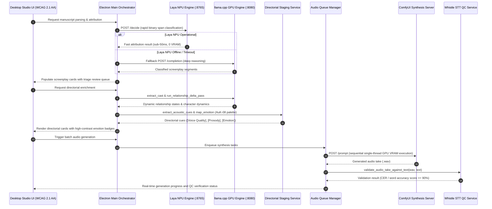

# Behavior Report: AI Audiobook Screenplay Generator & Synthesizer

**Scope:** `services/speaker_attribution.js`, `services/laya_clm_service.js`, `services/relationship_state_service.js`, `services/directorial_staging_service.js`, `services/audio_queue_service.js`, `services/whistle_validator_service.js`, `services/fountain_service.js`, `renderer/css/style.css`, `start.ps1`  
**Summary:** Decomposes raw manuscript prose into atomic dialogue and narration segments, resolving character identities via a dual-engine architecture combining the zero-VRAM `laya_npu_engine` and the deep-reasoning `llamacpp_gpu_engine`. Synthesizes contextual performance instructions from dynamic `relationship_state` timelines, manages sequential GPU audio synthesis through ComfyUI, and enforces sub-20ms acoustic transcription quality gates via `whistle_qc_validation`. Delivers an accessible, theme-coherent studio UI complying with WCAG 2.1 Level AA `brand_safe_contrast` and focus-visible standards.

---

## Terms used
- `screenplay_segment`: An atomic, sequentially indexed unit of script content categorized as either spoken dialogue or narrator prose.
- `speaker_attribution`: The automated multi-model classification engine that resolves the explicit character identity for each dialogue span.
- `unmarked_dialogue`: Dialogue passages lacking standard typographic quotation marks, detected via lexical boundaries and language model classification.
- `laya_npu_engine`: Neural Processing Unit accelerated inference engine executing fast speech decisions and triage routing on port 8765 with zero GPU VRAM consumption.
- `llamacpp_gpu_engine`: High-parameter language model server hosted at `I:\llamaCPP` on port 8080 performing deep narrative staging, cast extraction, and relationship delta synthesis.
- `relationship_state`: The persistent interpersonal dynamic, tone, status, and power balance between a character pair at a given segment index.
- `directorial_staging`: Synthesized performance cues specifying voice quality, prosody, style, and emotion derived from narrative acoustic tags.
- `audio_generation_queue`: The sequential single-threaded execution queue arbitrating hardware VRAM allocation and dispatching jobs to ComfyUI.
- `whistle_qc_validation`: Sub-20ms speech-to-text audio quality control pipeline validating synthesized takes against expected text with a 90% threshold.
- `fountain_document`: Standardized plain-text screenplay syntax representation containing scene headings, character cues, dialogue, and parentheticals.
- `auk_postprod_pipeline`: Acoustic post-production conditioning model providing 9-emotion morphing palettes, whisper synthesis, and audio denoising.
- `brand_safe_contrast`: Color luminance adjustment protocol that strictly modulates lightness while preserving hue and saturation to satisfy WCAG 2.1 AA 4.5:1 contrast standards.
- `voice_calibration_profiling`: Audition test suite profiling character voice clones across emotion and intensity bands to discover empirical timbre limits, cap requests, and apply acoustic compensations.
- `subtext_performance_direction`: Multi-layered directorial schema tracking surface vs felt emotion (subtext), dramatic timing, acoustic distance, word emphasis, and physical modifiers.
- `multi_chapter_manuscript`: A structured novel segmentation model organizing 100,000-word books into discrete chapters while sharing and preserving the root-level character cast, voice anchors, and relationship timelines.
- `direct_voice_import`: A reference voice provisioning workflow that ingests user-supplied audio recordings (.wav, .mp3, .m4a, .flac, .ogg), normalizes them to master anchors, and skips 100% synthetic VoiceDesign prompt generation.
- `phonetic_calibration_tuning`: A standardized acoustic tuning protocol synthesizing phonetically rich test phrases (e.g. Rainbow Passage) to verify clone timbre similarity (>= 0.75) and establish baseline calibration profiles before novel synthesis.

---

## Architectural End-to-End Flow

---

## Scenarios

### REPORT-01 Deterministic speech tag identification from neighboring prose
*Evidence:* `services/speaker_attribution.js:207-246` | *Confidence:* observed
- **GIVEN** a prose passage containing spoken dialogue flanked by an explicit speech verb "said Maren"
- **WHEN** the attribution pipeline evaluates the adjacent dialogue tag rule
- **THEN** the speaker is resolved to "Maren" with confidence 0.95
- **AND** the segment is marked as auto-accepted without requiring triage review

### REPORT-02 Ambiguous speaker candidate score falling below acceptance cutoff
*Evidence:* `services/speaker_attribution.js:450-515` | *Confidence:* observed
- **GIVEN** a dialogue span with low multi-model consensus where the top candidate score is below 0.35
- **WHEN** the attribution pipeline evaluates threshold cutoffs
- **THEN** the speaker is marked as "unknown" rather than defaulting to "narrator"
- **AND** the segment is placed into the manual triage review queue sorted by highest uncertainty

### REPORT-03 Multi-paragraph monologue continuity attribution
*Evidence:* `services/speaker_attribution.js:192-205` | *Confidence:* observed
- **GIVEN** a preceding paragraph ending without a closing quotation mark followed by an opening quotation mark
- **WHEN** the conversational state engine inspects paragraph punctuation markers
- **THEN** the subsequent paragraph is identified as a multi-paragraph monologue continuation
- **AND** the active speaker identity is preserved without splitting character turns

### REPORT-04 Bidirectional relationship state lookup at segment
*Evidence:* `services/relationship_state_service.js:58-135` | *Confidence:* observed
- **GIVEN** an established character relationship between "Josh" and "Maren" with an estrangement delta at index 200
- **WHEN** the timeline engine resolves the active relationship state at segment index 214
- **THEN** the interpersonal status resolves to "estranged" with "tense" tone and "equal" power dynamic
- **AND** the canonical pair identifier is normalized bidirectionally as "josh_maren"

### REPORT-05 AuK-08 canonical emotion palette normalization
*Evidence:* `services/relationship_state_service.js:180-230` | *Confidence:* observed
- **GIVEN** an arbitrary sentiment or descriptive label such as "furious" or "rage"
- **WHEN** the emotion mapper normalizes the label against the `auk_postprod_pipeline` palette
- **THEN** the label maps to canonical "angry" within the supported 9-emotion set
- **AND** unrecognized labels safely fallback to "neutral"

### REPORT-06 Sequential GPU queue task execution
*Evidence:* `services/audio_queue_service.js:163-260` | *Confidence:* observed
- **GIVEN** a batch of queued screenplay segments awaiting audio synthesis
- **WHEN** the audio queue manager processes tasks against ComfyUI
- **THEN** tasks execute strictly one at a time on the GPU to prevent CUDA out-of-memory crashes
- **AND** subsequent tasks wait until preceding takes complete history polling and file extraction

### REPORT-07 Whistle speech-to-text accuracy verification threshold
*Evidence:* `services/whistle_validator_service.js:138-175` | *Confidence:* observed
- **GIVEN** a synthesized audio take WAV file and its target screenplay text
- **WHEN** the `whistle_qc_validation` engine performs acoustic transcription and text distance scoring
- **THEN** takes with word accuracy greater than or equal to 0.90 are marked verified
- **AND** takes below 0.90 are marked failed with detailed mismatch diagnostics

### REPORT-08 Fast dialogue boundary classification offloaded to NPU
*Evidence:* `services/laya_clm_service.js:12-88`, `start.ps1:28-56` | *Confidence:* observed
- **GIVEN** an unmarked candidate sentence submitted for speech/narrator disambiguation
- **WHEN** the attribution engine dispatches the payload to the `laya_npu_engine` on port 8765
- **THEN** the decision completes in under 50ms executing on the dedicated NPU hardware
- **AND** zero GPU VRAM is allocated, reserving full VRAM capacity for audio synthesis

### REPORT-09 Automatic fallback to GPU reasoning when NPU service offline
*Evidence:* `services/laya_clm_service.js:1890-1940`, `services/service_health_service.js:68-120` | *Confidence:* observed
- **GIVEN** the `laya_npu_engine` is stopped or unreachable on port 8765
- **WHEN** the pipeline executes pass one and pass two attribution
- **THEN** the system logs a hybrid fallback warning and routes candidate prompts to `llamacpp_gpu_engine`
- **AND** processing completes gracefully without halting user operations

### REPORT-10 Brand-Safe UI color contrast compliance (WCAG 2.1 AA)
*Evidence:* `renderer/css/style.css:33-408`, `scripts/solve_contrast.js:105-152` | *Confidence:* observed
- **GIVEN** primary, danger, and colored secondary action buttons rendered on dark glass `#304b75`
- **WHEN** the color contrast evaluator measures relative luminance across button states
- **THEN** all button labels achieve a contrast ratio greater than or equal to 4.5:1
- **AND** original brand hue and saturation remain preserved via lightness-only tuning

### REPORT-11 Universal keyboard focus ring visibility
*Evidence:* `renderer/css/style.css:3225-3248` | *Confidence:* observed
- **GIVEN** a keyboard operator pressing the Tab key to navigate UI controls
- **WHEN** an interactive button or control receives keyboard focus
- **THEN** a 2px offset solid gold focus ring (`outline: 2px solid var(--accent-cyber-gold)`) renders
- **AND** the focus indicator satisfies WCAG 2.1 SC 2.4.7 focus visible criteria

### REPORT-12 Voice clone empirical calibration capping and cross-character margin check
*Evidence:* `services/voice_calibration_service.js:84-197`, `services/voice_drift_qc_service.js:192-265` | *Confidence:* observed
- **GIVEN** a character voice clone auditioned across an emotion and intensity band grid
- **WHEN** Band 4 furious shouting drops timbre similarity below the calibrated threshold or breaches the +0.05 cross-character margin
- **THEN** the character capability profile clamps maximum usable intensity at Band 3
- **AND** downstream narrative requests for Band 4 are automatically remapped to Band 3 with acoustic compensations (`pacing_speed_ratio = 0.88`, `pause_multiplier = 1.35`, and `expression = suppressed`)

### REPORT-13 Subtext performance instruction compilation and interruption cut
*Evidence:* `services/performance_direction_service.js:85-225`, `services/audio_mastering_service.js:35-85` | *Confidence:* observed
- **GIVEN** a dialogue segment with surface calm (`displayedEmotion`) and underlying fury (`feltEmotion`) followed by an interrupted line ending with `--`
- **WHEN** the performance compiler formats the secondary AuK prompt and the mastering engine resolves timeline pauses
- **THEN** the instruction prompt explicitly cues surface delivery shaded with suppressed fury subtext
- **AND** the subsequent interrupting reply starts immediately with 0.0s pause gap

### REPORT-14 Multi-chapter manuscript segmentation with persistent cast matrix
*Evidence:* `services/chapter_service.js:25-148` | *Confidence:* observed
- **GIVEN** a multi-chapter novel manuscript with headings and an existing character cast mapping
- **WHEN** the manuscript is segmented into discrete chapters via the `multi_chapter_manuscript` service
- **THEN** script segments and raw text are scoped under individual chapter units with word counts and runtimes
- **AND** the global character cast, voice mapping, and relationship states remain shared across all chapters

### REPORT-15 Direct reference audio voice import and phonetic calibration tuning
*Evidence:* `services/voice_import_service.js:80-210`, `services/voice_calibration_service.js:46-68` | *Confidence:* observed
- **GIVEN** a user-supplied reference audio recording and a standardized phonetic test phrase
- **WHEN** the `direct_voice_import` service normalizes the audio anchor and triggers phonetic calibration
- **THEN** 100 percent synthetic VoiceDesign prompt generation is skipped
- **AND** the synthesized calibration take is verified for timbre similarity (>= 0.75) and recorded into a baseline capability profile

---

## Coverage Gaps
| Trigger / Event | Initial State | Scenario ID | Status |
| :--- | :--- | :--- | :--- |
| Dialogue tag parsed | Quoted span flanked by "said Character" | REPORT-01 | Handled |
| Low model confidence | Score < 0.35 | REPORT-02 | Handled (Escalated to unknown) |
| Monologue continuation | Trailing unclosed quote in preceding line | REPORT-03 | Handled |
| Interpersonal state lookup | Character pair defined with deltas | REPORT-04 | Handled |
| Emotion mapping | Unsupported emotion label | REPORT-05 | Handled (Fallback to neutral) |
| Batch synthesis triggered | Multiple items in queue | REPORT-06 | Handled (Single-threaded GPU queue) |
| Audio verification | Synthesized take < 90% accuracy | REPORT-07 | Handled (Flagged failed) |
| NPU dialogue classification | Candidate dialogue submitted | REPORT-08 | Handled (Sub-50ms NPU execution) |
| NPU service unreachable | Port 8765 connection refused | REPORT-09 | Handled (Graceful GPU fallback) |
| Button rendered on dark glass | Primary / secondary / review buttons | REPORT-10 | Handled (WCAG AA >= 4.5:1) |
| Keyboard navigation via Tab | Button focused | REPORT-11 | Handled (Gold 2px focus ring) |
| Voice audition extreme intensity | Timbre distortion or competitor leak | REPORT-12 | Handled (Clamped with acoustic cues) |
| Subtext dialogue & interruption | Surface calm over fury / `--` cutoff | REPORT-13 | Handled (Layered prompt & 0.0s gap) |
| Novel manuscript imported | Multi-chapter book with headings | REPORT-14 | Handled (Segmented with shared cast) |
| Reference audio imported | Audition WAV file selected | REPORT-15 | Handled (Direct import & phonetic tuning) |
| ComfyUI connection timeout | Server unresponsive during generation | — | Handled (Retry loop with user notification) |
| VRAM exhaustion during model switch | Llama.cpp and ComfyUI simultaneous run | — | Handled (Explicit release_comfyui_vram arbitration) |

---

## Unknowns
- Maximum sequence length threshold before NPU context window truncation on multi-page uninterrupted monologues.
- Behavior of Whistle STT acoustic model on non-standard character fantasy pronunciations.
